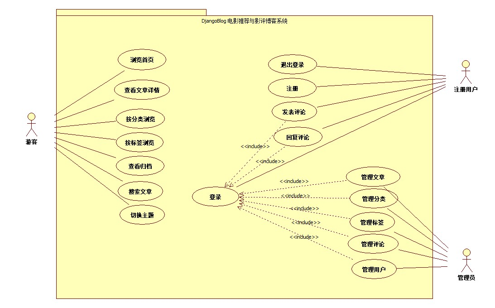

# 组员1：系统功能与用例分析

## 一、参与者识别

根据 DjangoBlog 电影推荐与影评博客系统的实际权限，系统参与者分为三类：

| 参与者 | 说明 |
|---|---|
| 游客（Visitor） | 未登录访问者，可浏览首页、文章详情、分类、标签、归档，使用搜索和主题切换 |
| 注册用户（User） | 登录后的用户，除游客权限外，可发表评论、回复评论、退出登录 |
| 管理员（Admin） | 拥有后台管理权限，可管理文章、分类、标签、评论和用户 |

## 二、功能清单

| 编号 | 功能名称 | 参与者 | 功能说明 | 确认依据 |
|---|---|---|---|---|
| F01 | 浏览首页 | 游客 | 显示近期文章、热门文章、分类、标签等 | 首页 / |
| F02 | 查看文章详情 | 游客 | 展示文章正文、分类、标签、评论等 | /article/<id>/ |
| F03 | 按分类浏览 | 游客 | 按电影类型筛选文章 | /category/<name>/ |
| F04 | 按标签浏览 | 游客 | 按标签筛选文章 | /tag/<name>/ |
| F05 | 查看归档 | 游客 | 按时间分组查看文章 | /archives/ |
| F06 | 搜索文章 | 游客 | 关键词搜索文章 | /search/ |
| F07 | 切换主题 | 游客 | 明/暗主题切换 | 导航栏主题按钮 |
| F08 | 登录 | 用户 | 账号密码登录 | /login/ |
| F09 | 退出登录 | 用户 | 退出当前账号 | 导航栏退出 |
| F10 | 注册 | 用户 | 新用户注册 | /register/（若存在） |
| F11 | 发表评论 | 用户 | 对文章发表评论 | 文章底部评论框 |
| F12 | 回复评论 | 用户 | 对已有评论回复 | 评论下方回复按钮 |
| F13 | 管理文章 | 管理员 | 后台增删改文章 | /admin/ |
| F14 | 管理分类 | 管理员 | 后台管理分类 | /admin/ |
| F15 | 管理标签 | 管理员 | 后台管理标签 | /admin/ |
| F16 | 管理评论 | 管理员 | 后台管理评论 | /admin/ |
| F17 | 管理用户 | 管理员 | 后台管理用户 | /admin/ |

> 注：以上功能均以实际运行的项目为准；未实现的功能不在清单中列出。

## 三、总体用例图

图 1 DjangoBlog 电影推荐与影评博客系统总体用例图

## 四、用例说明

### UC01 浏览首页

- 用例编号：UC01
- 用例名称：浏览首页
- 参与者：游客、注册用户
- 前置条件：系统已启动
- 基本流程：
  1. 用户访问站点首页
  2. 系统查询近期文章、热门文章、分类、标签
  3. 系统渲染首页并返回
- 异常流程：无
- 后置条件：首页正常显示

### UC02 查看文章详情

- 用例编号：UC02
- 用例名称：查看文章详情
- 参与者：游客、注册用户
- 前置条件：首页或列表页可访问
- 基本流程：
  1. 用户点击某篇文章
  2. 系统接收请求并查询文章
  3. 系统渲染详情页并返回
- 异常流程：文章不存在或已删除 → 返回 404
- 后置条件：文章详情页正常显示

### UC03 按分类浏览

- 用例编号：UC03
- 用例名称：按分类浏览
- 参与者：游客、注册用户
- 前置条件：系统内已有分类
- 基本流程：
  1. 用户点击导航栏某个分类
  2. 系统查询该分类下的文章
  3. 系统返回分类文章列表页
- 异常流程：分类下无文章 → 显示空列表
- 后置条件：分类列表页正常显示

### UC04 按标签浏览

- 用例编号：UC04
- 用例名称：按标签浏览
- 参与者：游客、注册用户
- 前置条件：系统内已有标签
- 基本流程：
  1. 用户点击文章中的某个标签
  2. 系统查询该标签下的文章
  3. 系统返回标签文章列表页
- 异常流程：标签下无文章 → 显示空列表
- 后置条件：标签列表页正常显示

### UC05 查看归档

- 用例编号：UC05
- 用例名称：查看归档
- 参与者：游客、注册用户
- 前置条件：系统内已有文章
- 基本流程：
  1. 用户点击“归档”
  2. 系统按年月分组查询文章
  3. 系统返回归档页
- 异常流程：无
- 后置条件：归档页正常显示

### UC06 搜索文章

- 用例编号：UC06
- 用例名称：搜索文章
- 参与者：游客、注册用户
- 前置条件：首页搜索框可用
- 基本流程：
  1. 用户输入关键词并提交
  2. 系统查询标题或正文匹配的文章
  3. 系统返回搜索结果页
- 异常流程：无匹配结果 → 显示空列表
- 后置条件：搜索结果页正常显示

### UC07 切换主题

- 用例编号：UC07
- 用例名称：切换主题
- 参与者：游客、注册用户
- 前置条件：导航栏存在主题按钮
- 基本流程：
  1. 用户点击主题切换按钮
  2. 系统切换明/暗主题
- 异常流程：无
- 后置条件：主题切换生效

### UC08 登录

- 用例编号：UC08
- 用例名称：登录
- 参与者：注册用户、管理员
- 前置条件：用户已注册
- 基本流程：
  1. 用户输入用户名和密码
  2. 系统校验凭据
  3. 校验通过则登录成功
- 异常流程：凭据错误 → 提示错误信息
- 后置条件：用户处于登录状态

### UC09 退出登录

- 用例编号：UC09
- 用例名称：退出登录
- 参与者：注册用户、管理员
- 前置条件：用户已登录
- 基本流程：
  1. 用户点击“退出”
  2. 系统清除会话
- 异常流程：无
- 后置条件：用户回到未登录状态

### UC10 注册

- 用例编号：UC10
- 用例名称：注册
- 参与者：游客
- 前置条件：项目提供注册入口
- 基本流程：
  1. 用户填写注册信息
  2. 系统校验用户名是否重复
  3. 系统创建用户
- 异常流程：用户名重复 → 提示错误
- 后置条件：注册成功后用户可登录

### UC11 发表评论

- 用例编号：UC11
- 用例名称：发表评论
- 参与者：注册用户
- 前置条件：用户已登录并打开某篇文章
- 基本流程：
  1. 用户输入评论内容
  2. 用户提交
  3. 系统保存评论并关联文章、用户
  4. 系统刷新详情页显示新评论
- 异常流程：评论内容为空 → 提示错误
- 后置条件：评论成功显示在详情页

### UC12 回复评论

- 用例编号：UC12
- 用例名称：回复评论
- 参与者：注册用户
- 前置条件：用户已登录且已存在评论
- 基本流程：
  1. 用户点击“回复”
  2. 输入回复内容并提交
  3. 系统保存回复并关联原评论
- 异常流程：内容为空 → 提示错误
- 后置条件：回复显示在评论下方

### UC13 管理文章

- 用例编号：UC13
- 用例名称：管理文章
- 参与者：管理员
- 前置条件：管理员已登录
- 基本流程：
  1. 管理员进入 /admin/
  2. 新增/修改/删除文章
  3. 系统保存变更
- 异常流程：字段校验失败 → 提示错误
- 后置条件：文章数据更新

### UC14 管理分类

- 用例编号：UC14
- 用例名称：管理分类
- 参与者：管理员
- 前置条件：管理员已登录
- 基本流程：管理员在后台新增/修改/删除分类
- 异常流程：字段校验失败 → 提示错误
- 后置条件：分类数据更新

### UC15 管理标签

- 用例编号：UC15
- 用例名称：管理标签
- 参与者：管理员
- 前置条件：管理员已登录
- 基本流程：管理员在后台新增/修改/删除标签
- 异常流程：字段校验失败 → 提示错误
- 后置条件：标签数据更新

### UC16 管理评论

- 用例编号：UC16
- 用例名称：管理评论
- 参与者：管理员
- 前置条件：管理员已登录
- 基本流程：管理员在后台审核/删除评论
- 异常流程：无
- 后置条件：评论数据更新

### UC17 管理用户

- 用例编号：UC17
- 用例名称：管理用户
- 参与者：管理员
- 前置条件：管理员已登录
- 基本流程：管理员在后台管理用户
- 异常流程：无
- 后置条件：用户数据更新