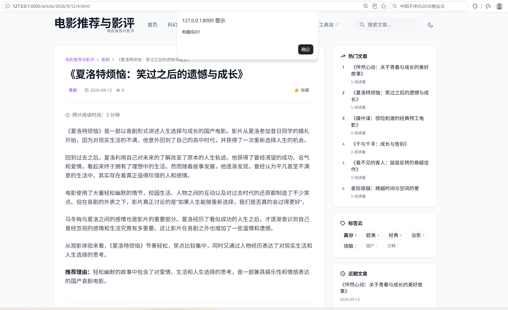

# 组员4：电影收藏功能交付说明

## 一、新增/修改文件清单
1. `src/favorites/`（新增独立 App，含 models.py, views.py, urls.py, templates/）
2. `src/djangoblog/settings.py`（修改，注册 favorites 应用）
3. `src/djangoblog/urls.py`（修改，配置 /favorites/ 路由）
4. `src/templates/blog/article_detail.html`（修改，新增收藏按钮与 AJAX 交互 JS）

## 二、功能说明
1. **独立数据模型**：新增 `Favorite` 模型，通过 `unique_together = ('user', 'article')` 从数据库层面保证同一用户对同一文章只能有一条有效记录。
2. **收藏/取消收藏**：用户点击详情页按钮发起 POST 请求，后端进行状态切换，前端不刷新页面即可看到状态变化。
3. **我的收藏列表**：提供 `/favorites/my/` 页面，展示当前用户的所有收藏记录，并可跳转回原文章。
4. **异常处理**：未登录用户点击会要求登录；文章不存在则返回错误，不会造成服务器崩溃。

## 三、测试截图
（这里插入你的测试截图）

